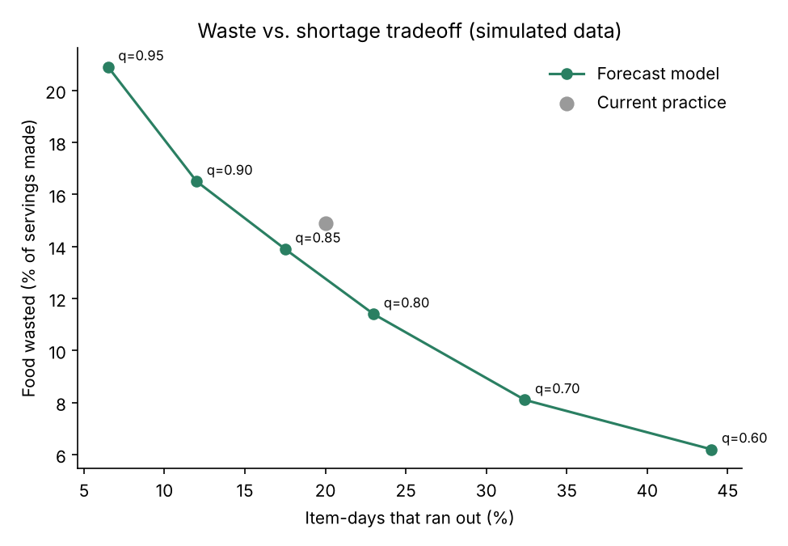

# Food Waste Forecaster

Forecasting school cafeteria demand so the kitchen makes less food that ends up in the trash, without running out.

This is a rebuild of the model from my past research, *Minimizing Food Waste Through AI* (2025). That study of a school cafeteria found that the biggest source of waste wasn't plate waste. It was **overproduction**: staff planned each day's batch from a rough visual estimate of recent leftovers, plus extra so they wouldn't run out. This project turns that into a proper forecasting problem.



## The idea

A cafeteria has to decide how much to cook **before** it knows demand. Making too much creates waste; making too little means students go without. So the model doesn't predict the *average* demand. It predicts a **high quantile** (by default the 85th percentile), which works like a dial between those two costs.

The chart above sweeps that dial. Each green point is a tradeoff the kitchen could choose. The grey point is current practice, which sits **above** the curve: at the same shortage rate, the model wastes less, and at the same waste it runs out less.

## Results (walk-forward backtest, 105 school days)

| | Current practice | Forecast model (q = 0.85) |
|---|---|---|
| Food wasted (% of servings made) | 14.9% | **13.9%** |
| Item-days that ran out | 20.0% | **17.5%** |
| Demand met | 97.9% | **98.5%** |
| Total servings wasted | 7,859 | **7,290** (−7.2%) |

A paired t-test on daily waste gives p = 0.024. The model improves on both waste and shortages at once, so this isn't just making less food.

By item, the gains come from the high-volume items (pizza −17%, fries −15%). The pastas are low-volume and noisy, and the model holds slightly more of them to keep shortages down. See `reports/by_item.csv`.

> **About the data.** The original study used one week of hand-recorded servings for pizza, butter pasta, red sauce pasta, burgers and fries, and I no longer have access to that raw data. This repo uses a **simulated** school year built on the same menu items and on the demand drivers that came up in my interviews with cafeteria staff and the survey of 83 students: day of week, attendance, school events (assemblies, exam days, early dismissals), and item popularity. The numbers above describe the method on that simulated data, not a real school. The 0.00037 p-value in the paper came from the original one-week study.

## How it works

1. **Simulate** (`src/foodwaste/simulate.py`): 175 school days × 5 menu items, with breaks, flu-season attendance dips, random school events and seasonal drift.
2. **Features** (`src/foodwaste/model.py`): yesterday's demand, the same weekday last week, a 10-day rolling mean and standard deviation, day of week, event flags and attendance. Every lag looks backward only, so there's no leakage. A test checks this.
3. **Model**: one `GradientBoostingRegressor` with quantile loss, shared across all items. It predicts demand as a *ratio* to the item's recent average, so pizza (≈140/day) and pasta (≈55/day) are on the same scale and every item's history teaches the model about Fridays and exam days. Pooling the items this way beat one model per item in my first version.
4. **Baseline**: a 10-day rolling average plus a 15% buffer, the same way the staff described planning.
5. **Backtest** (`src/foodwaste/evaluate.py`): walk-forward. The model is retrained every week on all earlier data and then plans the next week it has never seen, the way a kitchen would actually use it.

## Run it

```bash
pip install -r requirements.txt
python scripts/run_pipeline.py   # writes data/ and reports/ (about 1 minute)
pytest -q
```

## Limitations and next steps

- **Censored demand.** In real life you only observe *sales*, which can't exceed what was made. On a sell-out day, true demand is unknown. The simulation sidesteps this; a real deployment would need to handle it (for example, a Tobit-style model or treating sell-out days as lower bounds).
- **Menu substitution.** When pizza runs out, some of those students buy a burger. Items are modeled independently here.
- **Real data.** The obvious next step is a semester of real production and leftover logs from a cafeteria.

## Stack

Python, pandas, scikit-learn, SciPy, Matplotlib, pytest
